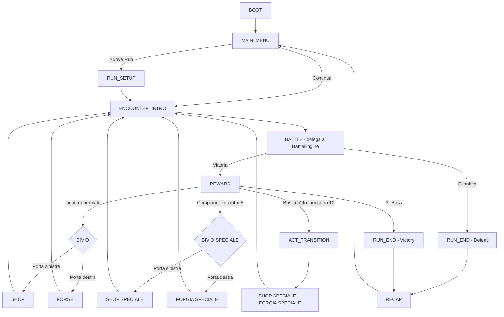

# Specifica di Design: Flusso di Gioco Completo (Game Flow)

Questo documento definisce **tutte le fasi del gioco** di *Dice Goblin* e i passaggi di ciascuna, dalla schermata di avvio alla fine della run. Introduce la macchina a stati di alto livello (`GameFlowState`) che orchestra le fasi e **delega** il combattimento alla macchina a stati già esistente del `BattleEngine` (GDD §5): due FSM separate, una per il *macro-loop* (run) e una per il *micro-loop* (turno).

---

## 0. Macchina a Stati di Alto Livello (GameFlowState)



```typescript
export enum GameFlowState {
    BOOT,             // Caricamento asset, meta e salvataggi
    MAIN_MENU,        // Continua / Nuova Run / Collezione
    RUN_SETUP,        // Reset stat, costruzione borsa iniziale
    ENCOUNTER_INTRO,  // Presentazione nemico e primo intento
    BATTLE,           // Delega alla FSM del BattleEngine
    REWARD,           // Bottino, sblocchi, avanzamento run
    INTERMISSION,     // Bivio: SHOP oppure FORGE (entrambi dopo i boss)
    SHOP,             // Il Mercante Goblin
    FORGE,            // La Forgia dei Dadi
    ACT_TRANSITION,   // Chiusura Atto: sblocco + cura + doppio intermezzo
    RUN_END,          // Vittoria (3° boss) o Sconfitta
    RECAP             // Statistiche della run, ritorno al menu
}
```

**Regola architetturale**: il `GameFlow` non conosce i dettagli del combattimento; entra in `BATTLE`, attende l'evento `onBattleEnded` del `BattleEngine` e riprende il controllo. Nessuna delle due FSM può saltare stati dell'altra.

---

## 0.bis Struttura della Run: una Boss Fight ogni 5 Incontri

Ogni Atto è composto da **10 incontri** con un climax ogni 5:

```
Atto:  [1] [2] [3] [4] [🏆5] [6] [7] [8] [9] [👑10]
                       Campione              Boss d'Atto
```

| Incontro | Tipo | Stat nemiche | Oro | Dopo la vittoria |
| :--- | :--- | :--- | :--- | :--- |
| 1-4, 6-9 | Normale | `base × 1.6^level` | `10 × 1.5^level` | Bivio normale (Shop *o* Forgia) |
| **5** | **🏆 Campione** (mid-boss) | `× 1.8` | `× 2` | **Bivio speciale** (Shop Speciale *o* Forgia Speciale) |
| **10** | **👑 Boss d'Atto** | `× 2.5` | `× 3` | `ACT_TRANSITION`: sblocco + cura + **entrambi gli speciali** |

Run completa = 3 Atti × 10 incontri = **30 incontri, 6 boss fight**. Il Campione spezza l'Atto in due archi da 5 e garantisce un picco di ricompensa a metà strada; solo il Boss d'Atto sblocca il dado permanente in Collezione.

---

## 1. Fase BOOT (Avvio)

Passaggi, in ordine rigido:

1. **Caricamento meta** (`SaveManager.loadUnlocks()`): il pool dei dadi sbloccati nelle run precedenti.
2. **Controllo run salvata** (`SaveManager.hasRun()`): determina se il menu mostrerà "Continua".
3. **Precaricamento asset**: inizializzazione `DiceWorld` (scena Three.js, mondo Cannon-es) a canvas nascosto, generazione delle `CanvasTexture` dei dadi base.
4. **Transizione automatica** a `MAIN_MENU` (nessun input richiesto; schermata di caricamento con barra se > 500ms).

*Fail-safe*: se il salvataggio run è corrotto, `loadRun()` ritorna `null` e il pulsante "Continua" non compare. Mai un crash al boot.

---

## 2. Fase MAIN_MENU (Schermata Iniziale)

| Voce | Visibile quando | Azione |
| :--- | :--- | :--- |
| **▶️ Continua** | Esiste run salvata valida | Idrata run, stat, borsa ed equip → `ENCOUNTER_INTRO` |
| **🔄 Nuova Run** | Sempre | Se esiste una run salvata chiede conferma (la sovrascrive) → `RUN_SETUP` |
| **🎲 Collezione** | Sempre | Mostra il pool completo: dadi base + sbloccati (evidenziati) + silhouette dei non ancora sbloccati |
| **⚙️ Opzioni** | Sempre | Volume, velocità animazioni dadi (×1 / ×2 / istantanea), reset meta (doppia conferma) |

La **Collezione** è la vetrina della meta-progressione: rende visibile *cosa manca*, che è il motore della rigiocabilità (MVP Specs §1).

---

## 3. Fase RUN_SETUP (Inizio Run)

Passaggi eseguiti in sequenza atomica (nessun autosave intermedio):

1. Reset `playerStats` ai valori base (STR 10, INT 1, VIT 12, LCK 10).
2. Reset `RunState`: Atto 1, incontro 1, oro 0, acquisti 0.
3. Svuotamento dei 5 slot equipaggiamento.
4. Costruzione della **borsa iniziale**: i 5 dadi base.
5. **Dote di partenza** *(nuovo)*: se il giocatore ha almeno 1 dado sbloccato in Collezione, sceglie **uno** dei dadi sbloccati da aggiungere alla borsa iniziale (6° dado). Ricompensa la meta-progressione senza gonfiare le stat: lo sblocco resta orizzontale, coerente con MVP Specs §1.
6. Primo autosave → `ENCOUNTER_INTRO`.

---

## 4. Fase ENCOUNTER_INTRO (Inizio dell'Incontro)

Sequenza di presentazione (durata target: < 2 secondi, skippabile con un tap):

1. **Runbar aggiornata**: `Atto X — Incontro Y/10` oppure `👑 BOSS`.
2. **Spawn del nemico**: nome, sprite/SVG, barra HP piena. I boss hanno nome proprio (es. *"Sir Baldovino il Molesto"*) e stat ×2.5.
3. **Creazione `BattleEngine`**: `new BattleEngine(playerStats, enemyStats, bag)` con `equipment.syncPipeline()`.
4. **Primo intento dichiarato**: il nemico mostra subito la sua prima azione (MVP Specs §2) — il giocatore pianifica *prima* del primo lancio.
5. Transizione a `BATTLE` con chiamata a `engine.initTurn()`.

---

## 5. Fase BATTLE (Combattimento)

Interamente delegata alla FSM del `BattleEngine` (GDD §5), qui riassunta per completezza del flusso:

| # | Stato Engine | Passaggi |
| :--- | :--- | :--- |
| 5.1 | `INIT_TURN` | Applica DoT, scadenza scudi, dichiara l'intento nemico |
| 5.2 | `ROLL_PHASE` | Catena di lancio (con Dopamine Cap a 30), lancio 3D bloccante (`waitUntilFinished`) |
| 5.3 | `WAIT_PLAYER_ACTION` | Input: una delle 4 skill; `Tiro Truccato` apre la sotto-modalità reroll (max 2 dadi) |
| 5.4 | `RESOLUTION` | Pipeline FLAT → MULT → skillMod (+ middleware equip), danno/scudo/veleno applicati |
| 5.5 | `ENEMY_PHASE` | Esecuzione deterministica dell'intento → ritorno a 5.1 |
| 5.6 | `VICTORY` / `DEFEAT` | `onBattleEnded` restituisce il controllo al GameFlow |

**Uscite**: Vittoria → `REWARD`. Sconfitta → `RUN_END` (la run è persa; il salvataggio run viene cancellato, la meta resta).

---

## 6. Fase REWARD (Bottino)

Passaggi:

1. **Oro**: `10 × 1.5^level` (×2 sul Campione, ×3 sul Boss d'Atto) — stessa base dei costi shop: potere d'acquisto costante (GDD §4.2).
2. **Avanzamento run**: `run.advance()` → `next-encounter` | `act-completed` | `run-completed`.
3. **Sblocco permanente** (solo Boss d'Atto): il dado dell'Atto entra in Collezione (`SaveManager.addUnlock`), banner celebrativo. Il Campione NON sblocca: il suo premio è l'intermezzo speciale.
4. **Autosave**.
5. Routing: incontro normale → `INTERMISSION` (bivio normale); **Campione → `INTERMISSION` speciale**; Boss d'Atto → `ACT_TRANSITION`; terzo Boss d'Atto → `RUN_END` (Victory).

---

## 7. Fase INTERMISSION (Il Bivio)

### Opzioni Valutate
*   **Opzione A (Shop e Forgia sempre entrambi)**: nessuna scelta, il giocatore visita tutto. Zero tensione decisionale, intermezzo lungo e ripetitivo.
*   **Opzione B (Alternanza fissa)**: shop dopo gli incontri pari, forgia dopo i dispari. Prevedibile, toglie agency.
*   **Opzione C (Bivio a scelta - SCELTA)**: dopo ogni vittoria normale compaiono **due porte**: 🛒 *Il Mercante* oppure 🔨 *La Forgia*. Il giocatore ne visita **una sola**. Dopo i boss (`ACT_TRANSITION`) si visitano entrambe.

### Soluzione Scelta (Opzione C)
Il bivio è una micro-decisione strategica a costo zero implementativo (stile bivi di *Slay the Spire*): compro potere ora (shop) o investo sulla borsa a lungo termine (forgia)? Rende ogni intermezzo una scelta di build e differenzia le run.

Passaggi della fase:
1. Overlay con le due porte (icona + una riga di anteprima: es. lo shop mostra l'oro disponibile, la forgia il numero di facce potenziabili).
2. Input: click su una porta → `SHOP` o `FORGE`.
3. Non c'è "indietro": la porta non scelta si chiude (feedback visivo).

### 7.bis Il Bivio Speciale (dopo il Campione)

Dopo l'incontro 5, le due porte diventano **dorate**: la scelta è tra 👑 *Mercante Reale* e 🔥 *Gran Forgia* — le versioni potenziate delle due fasi (vedi §8.bis e §9.bis). Stessa meccanica del bivio normale (una sola porta), ma con posta più alta: è il premio strutturale del mid-boss.

---

## 8. Fase SHOP (Il Mercante Goblin)

Ambito ridefinito: lo shop vende **potere e oggetti**, la manipolazione delle facce passa alla Forgia.

| Offerta | Effetto | Costo base | Note di scaling |
| :--- | :--- | :--- | :--- |
| 💪 +30% Forza | `str × 1.3` | 25 | Composto: acquisti ripetuti = crescita esponenziale allineata a 1.6^lv |
| ❤️ +25% Vitalità | `vit × 1.25` | 20 | HP massimi dalla prossima battaglia |
| 🎁 Oggetto equipaggiamento | 1 oggetto casuale non posseduto dei 6 del catalogo | 40 | Con 5 slot pieni l'acquisto chiede quale scartare (MVP Specs §4) |
| 🎲 Dado dal pool | Un dado sbloccato non in borsa | 80 | Solo se la Collezione ne offre |

Passaggi:
1. Generazione di 3-4 offerte (`Shop.generateOffers`) con costi `base × 1.5^level × 1.25^acquisti`.
2. Acquisti multipli finché l'oro basta (ogni acquisto: addebito → applica → autosave → rigenera viste).
3. **⚠️ Cambio rispetto all'MVP attuale**: gli oggetti equip non sono più gratuiti nell'inventario della HUD; si ottengono *solo* qui. L'inventario in battaglia mostra solo gli oggetti posseduti.
4. Uscita: pulsante "⚔️ Prossimo incontro" → `ENCOUNTER_INTRO`.

### 8.bis SHOP SPECIALE — 👑 Il Mercante Reale (dopo Campione e Boss d'Atto)

La versione potenziata dello shop. Differenze rispetto al Mercante normale:

| Modifica | Dettaglio | Razionale di bilanciamento |
| :--- | :--- | :--- |
| 💸 **Sconto 30%** | Tutti i prezzi × 0.7 | Il picco d'oro del boss (×2/×3) + sconto = il momento "spendi tutto" della run |
| 💎 **Offerta premium** | `+60% Forza` (costo base 60) | Doppio dell'upgrade normale: disponibile SOLO qui, spinge a conservare oro per i boss |
| 🎲 **Dado garantito** | Se la Collezione ha un dado non in borsa, l'offerta compare sempre | Rimuove la casualità dal premio più importante |
| 🃏 **4ª offerta extra** | Un oggetto equipaggiamento raro aggiuntivo | Più scelta = più decisioni di build |

Il rincaro `1.25^acquisti` resta attivo anche qui: comprare tanto dal Mercante Reale inasprisce i prezzi futuri di tutta la run.

---

## 9. Fase FORGE (La Forgia dei Dadi) — *nuova*

Il cuore identitario del *Dice Bag Builder*: qui si scolpisce la borsa. Tre servizi, tutti pagati in oro sulla curva `1.5^level`:

| Servizio | Effetto | Costo base | Guardrail di bilanciamento |
| :--- | :--- | :--- | :--- |
| 🔥 **Tempra** | Potenzia una faccia a scelta: NORMAL `×1.5` (floor), MULTIPLIER `+0.5` | 30 | Il +0.5 flat sui MULTIPLIER è volutamente cauto: quel valore entra in Fase MULT e si compone con tutto |
| ⚗️ **Trasmutazione** | Cambia il **tipo** di una faccia: NORMAL → MULTIPLIER (valore resettato a ×1.5), NORMAL → RECURSIVE, NORMAL → BUFF_STR | 90 | **Cap: max 3 facce non-NORMAL per dado.** Oltre, la trasmutazione è rifiutata: impedisce dadi "tutto-moltiplicatore" che romperebbero la curva 1.6^lv |
| ⚒️ **Fusione** | Sacrifica un dado: un altro dado eredita la sua faccia migliore (sostituendo la propria peggiore) e sale di 1 rarità | 60 | Riduce la borsa di 1 dado: meno lanci per turno in cambio di qualità. Trade-off reale, non potere gratis |

Passaggi della fase:
1. **Vista borsa**: i dadi in griglia; selezionando un dado si apre l'esploso delle 6 facce (riuso delle `CanvasTexture` esistenti).
2. Selezione faccia/dado → i 3 servizi mostrano anteprima *prima/dopo* e costo; i servizi non applicabili (cap raggiunto, oro insufficiente, ultima faccia NORMAL) sono disabilitati con motivazione nel tooltip.
3. Conferma → addebito, mutazione della faccia, `redrawFace()` sulla texture (aggiornamento GPU in-place, GDD §6.3), autosave.
4. Numero di operazioni per visita: **massimo 2** (contatore visibile). Impedisce di trasformare la forgia in uno shop infinito e mantiene il valore del bivio.
5. Uscita: "⚔️ Prossimo incontro" → `ENCOUNTER_INTRO`.

**Nota di scaling (dove agisce la Forgia)**: la Tempra su facce NORMAL è crescita *lineare* (Fase FLAT); Trasmutazione e Tempra su MULTIPLIER agiscono sulla Fase MULT, cioè sulla *base dell'esponenziale*. Per questo Trasmutazione costa 3× la Tempra e ha il cap per-dado: è l'operazione più potente del gioco.

### 9.bis FORGIA SPECIALE — 🔥 La Gran Forgia (dopo Campione e Boss d'Atto)

La versione potenziata della Forgia. Differenze:

| Modifica | Dettaglio | Razionale di bilanciamento |
| :--- | :--- | :--- |
| ⚒️ **3 operazioni** | Invece delle 2 standard | Il picco di potenziamento della borsa avviene sui boss, in sincrono col picco d'oro |
| ⚗️ **Trasmutazione -50%** | Costo base 45 invece di 90 | L'operazione più potente diventa accessibile SOLO nei momenti giusti della run |
| 🌋 **Riforgiatura** (esclusiva) | Rilancia i valori di TUTTE le facce NORMAL di un dado a `valore × 1.25` (floor), costo base 70 | Potenzia la Fase FLAT in blocco: forte ma lineare, non tocca l'esponenziale. Il cap di 3 facce non-NORMAL resta invariato anche qui |

---

## 10. Fase ACT_TRANSITION (Chiusura Atto)

Dopo ogni Boss d'Atto sconfitto (Atti 1 e 2):

1. Banner di sblocco del dado dell'Atto (da `REWARD`).
2. **Cura completa**: HP del Goblin ripristinati (unico heal del gioco: rende i boss un traguardo e giustifica run rischiose).
3. **Doppio intermezzo speciale**: si visitano **entrambe** 👑 Mercante Reale e 🔥 Gran Forgia, in quest'ordine, ciascuna con le regole speciali di §8.bis e §9.bis. È il momento di massimo potenziamento della run.
4. Autosave → `ENCOUNTER_INTRO` (Atto successivo, incontro 1).

---

## 11. Fase RUN_END e RECAP

| Esito | Trigger | Passaggi |
| :--- | :--- | :--- |
| **Victory** | 3° boss sconfitto | Salvataggio sblocco finale → schermata trionfo → `RECAP` |
| **Defeat** | HP Goblin ≤ 0 | `clearRun()` (la meta resta) → `RECAP` |

**RECAP** (statistiche della run, richiede un piccolo `RunStats` accumulato durante la partita):
*   Incontri superati, Atto raggiunto;
*   Danno massimo in un singolo turno (il numero "da screenshot");
*   Numero di overflow del Dopamine Cap;
*   Oro totale raccolto e speso, operazioni di forgia;
*   Pulsanti: "🔄 Nuova Run" / "🏠 Menu".

---

## 12. Punti di Autosave (riepilogo)

| Momento | Cosa viene salvato |
| :--- | :--- |
| Fine `RUN_SETUP` | Run fresca completa |
| Fine `REWARD` | Oro, avanzamento, (meta: sblocchi) |
| Ogni acquisto in `SHOP` | Oro, stat/equip/borsa |
| Ogni operazione in `FORGE` | Oro, borsa (facce mutate) |
| Modifica equip in battaglia | Slot |
| `DEFEAT` / `RUN_END` | Cancellazione run (la meta persiste sempre) |

Il salvataggio è sempre **a fine passaggio atomico**: mai a metà di una transazione (niente stati "oro scalato ma effetto non applicato").

---

## 13. Impatti sull'Implementazione (roadmap commit)

| Commit | Contenuto | Moduli |
| :--- | :--- | :--- |
| 15 | `GameFlow.ts`: FSM di alto livello + stati `MAIN_MENU`/`RECAP` in UI | `src/core/GameFlow.ts`, `App.svelte` |
| 16 | `ForgeManager.ts`: Tempra/Trasmutazione/Fusione con guardrail + test | `src/core/Forge.ts`, `tests/forge.test.ts` |
| 17 | Bivio `INTERMISSION` + spostamento oggetti equip nello shop + dote di partenza | `GameManager.ts`, `Shop.ts`, UI |
| 18 | `RunStats` + schermata `RECAP` + Collezione nel menu | `src/core/RunStats.ts`, UI |

Le fondamenta esistenti restano invariate: `BattleEngine`, pipeline, `RunManager`, `SaveManager` (va solo esteso il formato `SavedRun` v2 con `runStats` e contatore forgia — retro-compatibile grazie al campo `version`).
